  

  

  
  
  

## `$ whoami`

Software Engineering undergraduate building dependable backend systems and practical AI tools. I work across APIs, distributed services, model integration, testing, and deployment.

## `$ printenv ENGINEERING_STACK`

  

## `$ watch github --telemetry`

  
  

  

## `$ ncal --contributions --full-year`

  

